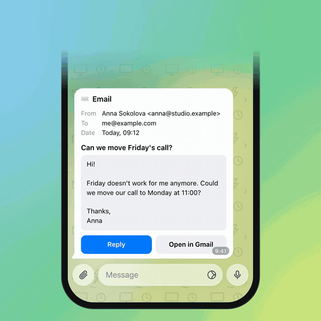
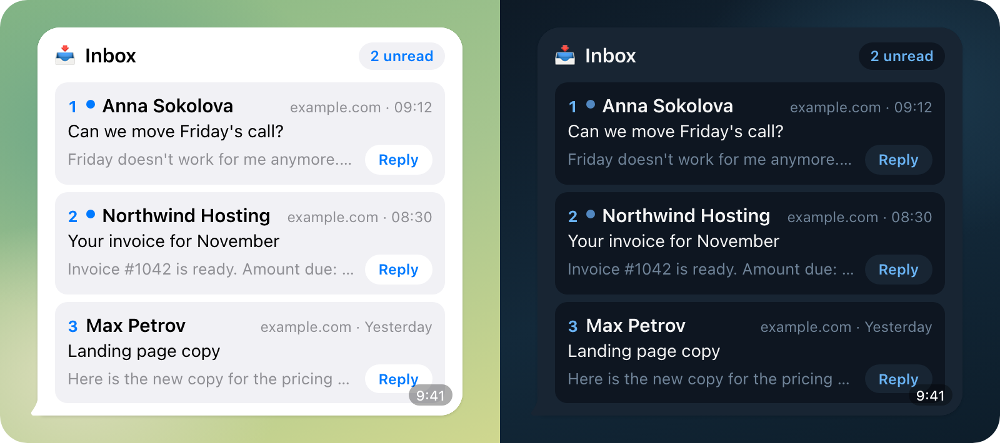
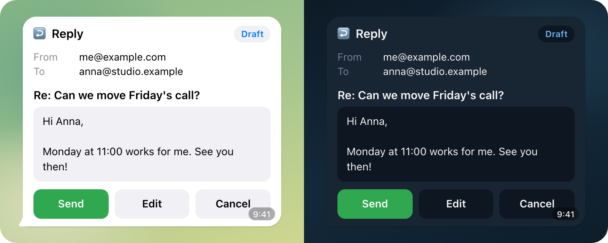
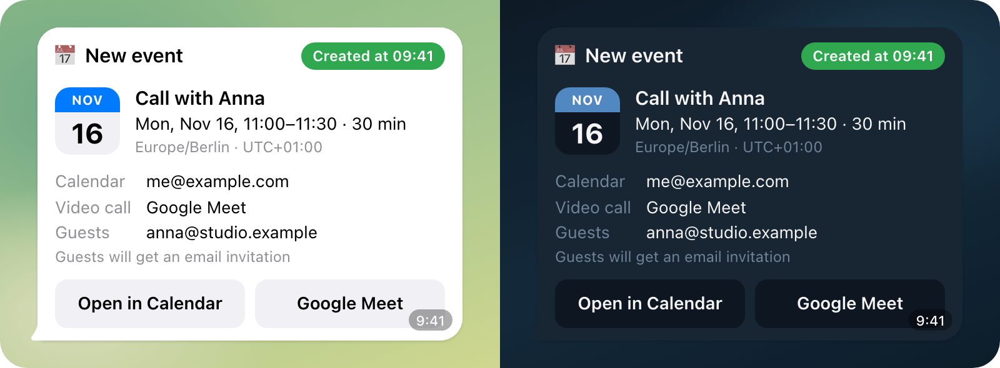
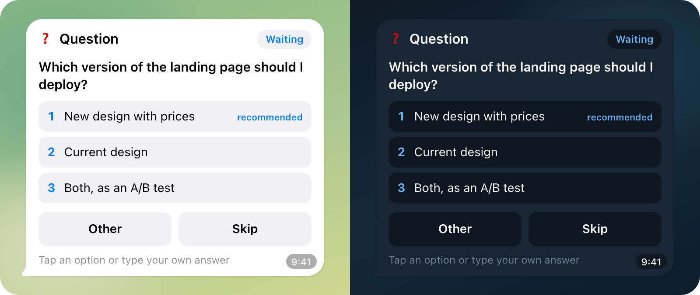
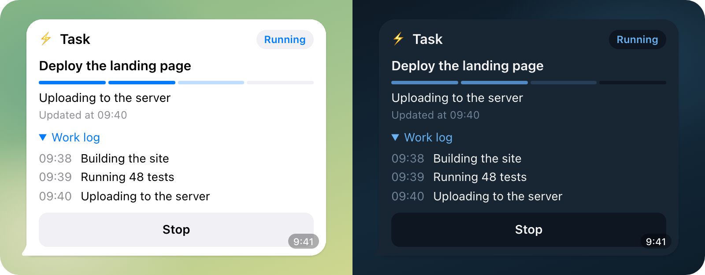
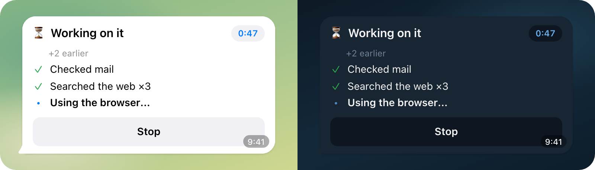
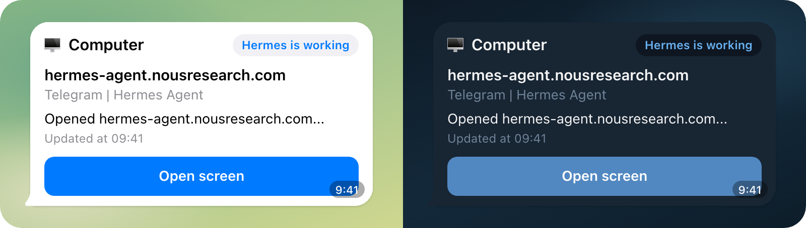
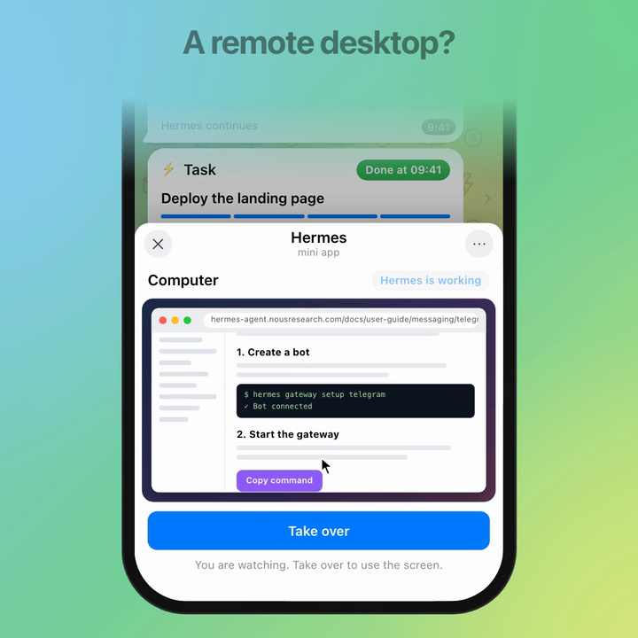

# Hermes Telegram widgets

Native Telegram widgets for [Hermes Agent](https://github.com/NousResearch/hermes-agent): email, calendar, choices, task status, progress and the agent's screen, right in the chat.

<p align="center"></p>

Telegram [Bot API 10.4](https://core.telegram.org/bots/api-changelog) (November 9, 2026) lets a bot send a message as a small HTML app: a [widget](https://core.telegram.org/bots/widgets). These plugins teach Hermes to use them. You see exactly what Hermes is about to do, and you decide with one tap.

No vendor lock-in: your Hermes, your server, any model, and Telegram as the UI.

## Widgets

Every card works in the light and the dark Telegram theme. Screenshots and the demo use made-up data.

### Inbox · [`telegram-inbox-widget`](telegram-inbox-widget)

Your latest emails as a card. Tap an email to read it, tap Reply to get a draft.



### Email · [`telegram-email-widget`](telegram-email-widget)

A draft with Send, Edit and Cancel. Nothing is sent before you tap Send. The same card then says "Sent at 09:41".



### Calendar · [`telegram-calendar-widget`](telegram-calendar-widget)

An event draft with Create. After the tap, Hermes reads the event back from Google Calendar and checks it.



### Choice · [`telegram-clarify-widget`](telegram-clarify-widget)

When Hermes asks you something, every option is a button. Other and Skip are there too.



### Task · [`telegram-activity-widget`](telegram-activity-widget)

A live card for a long task: progress, current step, work log and Stop.



### Progress · [`telegram-progress-widget`](telegram-progress-widget)

When a reply takes longer than 8 seconds, a "Working on it" card shows a timer, the latest steps and Stop. It goes away when the answer arrives, so the chat keeps only the answer.



### Computer · [`telegram-agent-computer`](telegram-agent-computer)

While Hermes uses its browser, a card shows what it does. Open screen shows the live desktop in a Telegram Mini App, with Take over and Hand back.



<p align="center"></p>

## How it works

- A widget is one HTML message, at most 4 KB after compression. The cards here take about 1.4–2.2 KB.
- The HTML never changes after sending. Hermes changes only the card's state (`chat_data`, up to 1024 bytes) with `editMessageWidgetData`, so the same message goes from "Draft" to "Sent".
- Buttons are inside the card. A tap is a widget request (`widget_query`). The plugin accepts it only from the card's owner, on that card's message, once. The state change is saved before anything runs, so a double tap or a restart never sends twice.
- Text from emails and pages is treated as data, not instructions, when it goes back to the agent.
- English by default, Russian when Hermes runs in Russian.
- python-telegram-bot 22.8 does not know `widget_query` yet. The plugins add it to the update types Hermes polls for.

Each plugin's README has the details.

## Requirements

- Your own Hermes Agent with the Telegram gateway: your own bot, a private chat with it.
- A Telegram app with widget support (Bot API 10.4).
- The [`gog`](https://gogcli.sh) CLI, signed in to your Google account, for email, inbox and calendar.
- For the computer card: Hermes Bot Desktop, a headed browser, `webapp.public_url`, and a Mini App registered in BotFather. See [`telegram-agent-computer/README.md`](telegram-agent-computer/README.md).

## Install

Copy the plugins you want into `~/.hermes/plugins/` on the Hermes host and enable them:

```bash
git clone https://github.com/KirillAkimkin/hermes-telegram-widgets.git
cp -r hermes-telegram-widgets/telegram-email-widget ~/.hermes/plugins/
hermes plugins enable telegram-email-widget
```

Edit, Reply, Stop and the computer hand-back pass a request back to the agent. For those, allow it per plugin:

```yaml
plugins:
  entries:
    telegram-email-widget:
      allow_gateway_injection: true
```

Then restart the gateway.

## Tests

```bash
for d in telegram-*/; do
  (cd "$d" && PYTHONPATH=../stubs uv run -q --python 3.11 --with pytest --with fastapi --with httpx \
    --with python-telegram-bot==22.8 python -m pytest -q -p no:cacheprovider tests)
done
```

305 tests. `stubs/` replaces the one Hermes gateway module the tests import. The card-script tests run the widget JS in Node and are skipped without `node`.

## What's next

I built this for my own Hermes. I add a new scenario every time I need one. Next on the list: results and files, schedules, permission requests. Ideas are welcome in issues.

## License

MIT, see [LICENSE](LICENSE). The vendored noVNC 1.7.0 in `telegram-agent-computer/dashboard/novnc/` keeps its own MPL-2.0 license.
